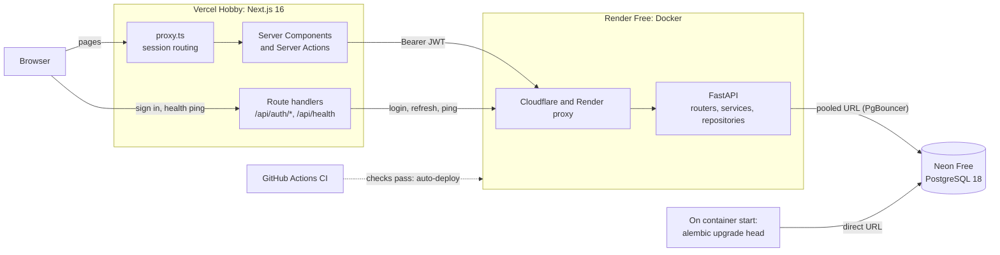

# Fleet Manager

Track a vehicle fleet's status, maintenance, fuel costs and driver licenses: a REST API (FastAPI + PostgreSQL) with a Next.js dashboard, deployed entirely on free tiers.

[](https://github.com/Awsthyn/fleet-manager/actions/workflows/ci.yml)
[](https://github.com/Awsthyn/fleet-manager/actions/workflows/ci.yml)
[](LICENSE)

## [▶ Live demo](https://fleet-manager-lake-eight.vercel.app) · [API docs](https://fleet-manager-api-01nn.onrender.com/docs)

- **Dashboard:** click **Try the demo**. No sign-up; read-only access.
- **API docs (Swagger):** **Authorize** with `demo@fleet.dev` / `demo-password` (read-only viewer).
- **The first visit can take up to a minute** (about 20 s measured): the API sleeps after 15 idle minutes on Render's free tier. The dashboard shows a "waking up" notice meanwhile.

All data is fictional.


## What it does

- **See the fleet at a glance:** vehicles by status, overdue maintenance, active drivers and licenses about to expire.
- **Know what needs service next:** overdue and upcoming maintenance, most urgent first, with the reason ("4,266 km past the service interval", "2 days past due").
- **Follow costs:** maintenance vs fuel spend per month; the API also reports fuel efficiency (km per liter) per vehicle.
- **Browse and search vehicles:** filter by status, search by plate, brand or model, and open a vehicle to see its driver and latest maintenance.
- **Catch expiring licenses:** the drivers page flags active drivers whose license expires within 30 days.
- **Roles:** viewers read everything; admins also create and edit (the API enforces it on every write).

## Architecture



How a request flows (a viewer opens **Vehicles**):

1. The browser requests `/vehicles` from Vercel. `proxy.ts` checks for the session cookies: none → `/login`; refresh cookie only (access token expired) → `/session/resume`, which renews it and comes back.
2. A Server Component reads the access token from its httpOnly cookie and calls `GET /api/v1/vehicles` on Render with it. The browser never talks to the API or sees a token.
3. Behind Cloudflare and Render's proxy, Uvicorn resolves the real client address, then FastAPI validates the JWT and the role.
4. The router calls the vehicle service, the service calls the repository, and the repository runs the queries on Neon: a count, the page, and the drivers in one `IN (...)` query.
5. The response is rendered to HTML on Vercel and streamed to the browser.

## Tech stack

| Layer | Technology |
|---|---|
| API | Python 3.12, FastAPI, Pydantic v2, pydantic-settings, uv |
| Data | PostgreSQL 18 (Neon), SQLAlchemy 2.0 async + asyncpg, Alembic |
| Auth | JWT (PyJWT, access 15 min + refresh 7 days), Argon2 password hashes (pwdlib) |
| Dashboard | Next.js 16 (App Router, Cache Components), TypeScript strict, Tailwind CSS 4, shadcn/ui, Recharts |
| Quality | pytest + httpx, pytest-cov, Ruff, pyright (strict), Vitest + Testing Library, ESLint, pre-commit |
| Infrastructure | Docker, Render Free (API), Vercel Hobby (dashboard), Neon Free (database), GitHub Actions |

## Engineering decisions

**1. Routers → services → repositories, one direction only.** Routers only translate HTTP, services hold the rules, and repositories are the only code that touches the database session, including commits. Writes run inside savepoints, and constraint violations come back as typed errors (duplicate plate → `409 conflict`) instead of raw database exceptions.
*Trade-off:* more files and indirection than calling the ORM from the endpoint, which a CRUD this size could get away with.

**2. N+1 queries fail loudly and are measured in a test.** Every relationship is `lazy="raise_on_sql"`, so an accidental lazy load raises instead of silently querying, and the vehicle list loads drivers with `selectinload`. [`tests/test_n_plus_one.py`](tests/test_n_plus_one.py) records every SQL statement while listing 5 and then 25 vehicles and requires the same number of SELECTs both times, at most 3.
*Trade-off:* every query must declare what it loads up front; forgetting it is a runtime error, caught only if a test exercises that path.

**3. Tokens never reach browser JavaScript.** The dashboard is a backend-for-frontend: Next.js route handlers exchange credentials for tokens and keep them in `httpOnly; Secure; SameSite=Lax` cookies, and pages call the API from the server. Refreshing an expired session is deliberately done from the browser (`/session/resume`): after 15 idle minutes the token is expired *and* the API is asleep, and doing the refresh client-side lets the "waking up" notice show instead of a blank page.
*Trade-off:* every API call goes through Vercel (an extra hop), and the API sees Vercel's address instead of the visitor's.

**4. Migrations run when the container starts.** Render Free has no pre-deploy step, so the entrypoint ([`app/scripts/start.py`](app/scripts/start.py)) runs `alembic upgrade head` on Neon's direct URL, then starts Uvicorn. If the migration fails, the process exits with status 1 before binding the port: better down than serving a half-migrated schema. CI builds the image and boots it against an empty PostgreSQL on every push.
*Trade-off:* every cold start pays for an Alembic check (a no-op when current), and this only works with a single instance; several instances would race to migrate.

**5. The login rate limit uses the real client address, found by reading production logs.** Render appends to a client-supplied `X-Forwarded-For` instead of replacing it, so trusting every proxy let anyone dodge the limit with a fake header (verified against the live service). Logging the raw header chain showed `<spoofed>, <client>, <Cloudflare>, <Render 10.x>`, so Uvicorn now trusts only private networks and Cloudflare's published ranges ([`app/core/proxies.py`](app/core/proxies.py)). Only failed logins count, because every demo visitor signs in from the dashboard server's address.
*Trade-off:* the Cloudflare range list is maintained by hand, and the counters live in process memory (fine for one instance, wrong for several).

**6. Metrics are computed in SQL, not in Python.** Overdue maintenance takes the latest record per vehicle and type with `row_number()`, fuel efficiency pairs consecutive fills with `LAG()`, and costs are grouped by calendar month in Argentina time (UTC-3). Python receives one row per status, month or vehicle; it only shapes them and fills months without data with zeros.
*Trade-off:* the SQL is harder to read than a loop; every rule is pinned by tests with hand-built fixtures (including superseded records) to keep it correct.

## Quality

| Check | Result |
|---|---|
| API tests (pytest, against a real PostgreSQL 18 with all migrations applied) | **144 passed** |
| API coverage (lines and branches) | **97.79 %**, CI fails below 80 % |
| Dashboard tests (Vitest) | **5 passed** |
| Type checking | pyright strict (API), `tsc --noEmit` strict (dashboard) |
| Lint and format | Ruff (API), ESLint (dashboard) |

Every push and pull request runs four CI jobs: API lint, types and tests with the coverage gate; a Docker build that boots the image against an empty database and expects the migration and `/health` to succeed; dashboard lint, typecheck, tests and build; and, on `main`, the coverage badge. Each API test runs inside a transaction that is rolled back afterwards, and a test fails if the models and migrations drift apart.

## Run locally

Requirements: [uv](https://docs.astral.sh/uv/) (installs the pinned Python), Docker, and Node.js 24+. Commands for bash (on Windows, Git Bash).

```bash
git clone https://github.com/Awsthyn/fleet-manager.git
cd fleet-manager

# API: dependencies, local PostgreSQL 18 (127.0.0.1:5433), schema and fictional data
uv sync
docker compose up -d db
cp .env.example .env
uv run alembic upgrade head
uv run python -m app.scripts.seed
uv run uvicorn app.main:app --reload       # http://127.0.0.1:8000/docs
```

In a second terminal:

```bash
cd fleet-manager/web
npm install
cp .env.example .env.local
npm run dev                                # http://localhost:3000 → Try the demo
```

The example files work together as they are: the seed creates `demo@fleet.dev` with the same placeholder password the dashboard uses. Tests: `uv run pytest` (needs the docker-compose database) and `npm test` in `web/`.

More detail: [API reference](docs/api.md) · [Operations: database, tests, logging, deploy](docs/operations.md) · [Dashboard](web/README.md)

## Limitations & what I'd do next

**Limitations**

- **Cold starts:** after 15 idle minutes the API sleeps; the first request took 22.4 s in a measurement (up to a minute is possible), and Neon's compute adds a slower first query after 5 idle minutes.
- **Single instance by design:** login rate-limit counters live in process memory and migrations run on start, both correct only with one API instance (which is all Render Free gives).
- **No per-token logout:** tokens are stateless JWTs. Signing out clears the cookies, but a copied refresh token stays valid for up to 7 days unless the user is deactivated.
- **Dashboard scope:** it edits vehicles only; maintenance records, fuel logs and drivers are managed through the API.
- **Free-tier quotas:** 750 Render instance hours per month and 1 GB of Neon storage.

**Next**

1. **Refresh-token rotation with revocation in PostgreSQL**, so signing out really invalidates a session and stolen refresh tokens are detected on reuse.
2. **Move the rate-limit counters to PostgreSQL**, the only state shared between instances on this stack, to make horizontal scaling safe.
3. **Browser end-to-end tests in CI** (Playwright against the docker-compose stack) for login, the session refresh and the admin forms, which are currently verified by hand.

## Attributions & license

Built with [FastAPI](https://fastapi.tiangolo.com/), [SQLAlchemy](https://www.sqlalchemy.org/), [Next.js](https://nextjs.org/), [shadcn/ui](https://ui.shadcn.com/), [Recharts](https://recharts.org/) and [Lucide](https://lucide.dev/) icons. Hosted on the free tiers of [Render](https://render.com/), [Vercel](https://vercel.com/) and [Neon](https://neon.com/). Vehicles, plates (all start with `ZZ`), drivers and costs are generated fictional data.

[MIT](LICENSE) © 2026 Awsthyn
